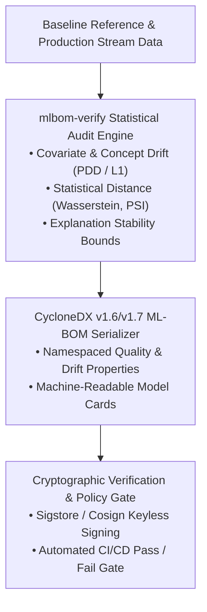

# mlbom-verify

Automated Quality, Drift, and Explainability Verification for the Open AI/ML Supply Chain.

[](LICENSE)
[](https://cyclonedx.org)
[](https://sigstore.dev)

---

## Overview

Modern software pipelines increasingly ingest and deploy open-source machine learning models. However, standard Software Bill of Materials (SBOM) scanners inspect only source code, licenses, and known CVEs. They treat model artifacts as opaque binaries and cannot detect when model behavior silently decays due to data drift, concept drift, or covariate shifts.

`mlbom-verify` bridges software supply chain security and statistical machine learning verification. It automates model quality auditing, computes statistical drift metrics, checks explanation stability bounds, and serialises the resulting verification metadata into standardized **CycloneDX Machine Learning Bill of Materials (ML-BOM)**.



## Key Capabilities

- **Statistical Drift Engine:** Computes Wasserstein distance, Population Stability Index (PSI), and Kolmogorov-Smirnov tests across feature streams using local quantile sketches and binned histograms.
- **Concept & Profile Drift Detection:** Integrates the Profile Drift Detection (PDD) method based on Partial Dependence Profiles ([Dar & Cavus, 2026](#references)), providing interpretable diagnostics on which variables drive prediction shift.
- **Dynamic Model Card & Explanation Verification:** Converts static Model Card metadata into verifiable runtime declarations and verifies explanation stability bounds inspired by Explanation Cards ([Günther et al., 2026](#references)).
- **Zero-Knowledge Privacy:** Uses data sketches and SHA-256 reference digests. Raw training or inference logs are never embedded in the exported ML-BOM artifact.
- **Standardized Output:** Serialises evaluation results directly into OWASP CycloneDX v1.6+ ML-BOM format using namespaced properties (`mlbom:drift:*`, `mlbom:explanation:*`).
- **Cryptographic Supply Chain Signing:** Pairs with Sigstore (`cosign`) to sign ML-BOMs as tamper-proof verification records in CI/CD pipelines.

## CLI Usage (Specification)

```bash
# Audit a model against a baseline summary and production batch
mlbom-verify audit \
  --model models/credit_risk.onnx \
  --baseline data/baseline_summary.json \
  --stream data/prod_batch_2026_w44.parquet \
  --drift-threshold 0.15 \
  --output bom.cdx.json

# Sign the resulting ML-BOM with Sigstore
cosign sign-blob --bundle bom.bundle bom.cdx.json

# Validate an incoming ML-BOM in CI/CD before deployment
mlbom-verify verify \
  --bom bom.cdx.json \
  --strict
```

## Example CycloneDX ML-BOM Artifact & Walkthrough

- **Sample Artifact:** A complete CycloneDX v1.6 attestation file demonstrating how drift metrics and model properties are serialised is available in [`examples/sample-mlbom.cdx.json`](examples/sample-mlbom.cdx.json).
- **End-to-End Walkthrough:** A step-by-step scenario demonstrating how `mlbom-verify` detects silent model degradation and blocks a faulty CI/CD deployment is provided in [`examples/walkthrough/README.md`](examples/walkthrough/README.md).

## CI/CD Integration

`mlbom-verify` is designed to run as a native quality gate in automated CI/CD pipelines:

```yaml
# .github/workflows/ml-quality-gate.yml
name: Model Quality Gate
on: [push, pull_request]

jobs:
  verify:
    runs-on: ubuntu-latest
    steps:
      - uses: actions/checkout@v4
      - name: Run mlbom-verify Audit
        run: |
          mlbom-verify audit \
            --model models/classifier.onnx \
            --baseline metadata/baseline.json \
            --stream data/validation_split.parquet \
            --output mlbom.cdx.json
```

## References

- **Dar, U. and Cavus, M. (2026).** *From XAI to MLOps: Explainable concept drift detection with the partial dependence profiles-based approach.* **Future Generation Computer Systems**, 183, 108586. [doi:10.1016/j.future.2026.108586](https://doi.org/10.1016/j.future.2026.108586)
- **Dar, U. and Cavus, M. (2026).** *datadriftR: An R package for data drift detection.* **Journal of Open Source Software**, 11(119), 9481.
- **Mitchell, M. et al. (2019).** *Model Cards for Model Reporting.* **ACM FAccT**, 220–229.
- **Günther, E. et al. (2026).** *We Need Explanation Cards to Connect Explanation Algorithms to the Real World.* **arXiv preprint** arXiv:2606.16786.
- **CycloneDX Specification:** [https://cyclonedx.org](https://cyclonedx.org)
- **Sigstore:** [https://sigstore.dev](https://sigstore.dev)

## License

This project is licensed under the Apache License 2.0 - see the [LICENSE](LICENSE) file for details.
